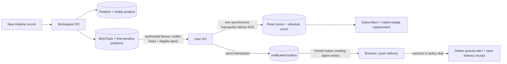

# User-owned unread state

The workspace owns the timeline and message ordering. Each User DO owns its user's private read
horizons, unread counts and outbound alert queue. No read receipts are exposed to other users.

## Visible positions, not timeline scans

Raw `sequence` still identifies every timeline record, including tools and reasoning. Every newly
written record also stores `visibleThroughSequence`: the number of visible messages through that
record. Only nonempty text or attachments count; generated slash-command expansions do not.
Non-visible records carry the current prefix without incrementing it. Existing record updates
preserve their prefix. Visible messages are append-only; deletion removes the whole thread and
its counts rather than renumbering history.

The workspace extends its existing `nextChatSequences` row with the visible counter and first
tracked raw position. The counter, stamped record and dirty marker commit synchronously through
the typed-storage write transaction. Raw sequence allocation preserves the visible counter.
Fanout carries an absolute visible head, so duplicate/older deliveries never increment counts.

There is **no historical backfill**, workspace enumeration or rollout-time recipient RPC. Old
records remain unnumbered and are treated as already read. If the first delivered visible message
is 4, the User DO initializes its read-visible horizon to 3. For a coalesced first batch 4..6,
the source's durable dirty row retains 4 and the resulting unread count is 3. Metadata-only updates
do not initialize missing cursors. An explicit “mark unread” in unnumbered history counts only
newly numbered messages, not that history.

## User storage and local reads

Each `chatReadCursors` row contains:

- `workspaceId`, `chatId`
- `readThroughSequence`: inclusive raw UI horizon, -1 means before the timeline
- `readThroughVisibleSequence`: corresponding dense visible horizon, initially 0
- `latestVisibleSequence`: latest accepted visible head, monotonic
- `unreadCount`: `latestVisibleSequence - readThroughVisibleSequence`
- `notifiedThroughSequence`: completed-alert deduplication receipt, in raw coordinates
- `deleted`, only on a deleted thread's tombstone

`notificationOutbox` contains the accepted alerts themselves: stable UUID, kind, bounded chat
title, workspace/thread IDs and raw sequence. It is ordered by workspace, chat and raw sequence.
The queue is the work record: there is no User DO notification dirty bit, history-fetch cursor,
denial flag, new timer or notification backfill process.

Counts and queue headers hydrate from local storage once per User DO lifetime. Snapshot reads
and subscriptions use that memory, never list threads on other DOs, and never write read rows.
UI titles/previews and timeline boundaries use the separate authorized workspace metadata path;
metadata failure does not invalidate badge totals. Native badge replacement uses the existing
versioned `notificationBadge` scalar outbox; its version is not a read-state/source version.

## Handoff, retries and eviction

1. The workspace commits the new record, visible counter and `dirtyChats` marker. Its existing
   shared alarm is armed before async dispatch. The marker retains the earliest pending raw event
   and first visible position, including through coalescing and resets.
2. The workspace reads pending eligibility records once per batch and checks current build
   membership plus previously established observer admission locally. It sends authorized packets
   to the owner and established collaborators in parallel; independent threads also fan out in
   parallel. It does not enroll observers or call external gatekeeper verifiers per message.
3. A listed User DO synchronously commits the absolute head/count and any new queued alerts in
   one transaction. Queue insertion is deduplicated by chat/raw position and the completed-delivery
   receipt. It arms the existing alarm before ACK. Slow browser/provider delivery does not hold
   up that ACK or later count updates.
4. If everyone ACKs or is intentionally skipped, the workspace clears the marker without writing
   recipient bookkeeping. Otherwise it writes only `failedRecipients` on that same row. Each entry
   keeps its earliest pending raw/visible positions; `retryOnly` means no new broadcast remains.
   Subsequent attempts target only those failures, rechecking current admission. An unchanged
   repeated failure needs no row rewrite. New mutations still broadcast to everyone, retaining
   older work only for failed recipients. Mutations during an await become the next broadcast,
   without being erased by the older pass's checkpoint or delayed by its retry backoff.
5. The User DO drains each chat's local queue under its existing per-thread mutex. It awaits
   delivery or an intentional policy skip, then atomically deletes that item and advances
   `notifiedThroughSequence`. Three coalesced alerts remain three ordered delivery attempts.

Count arithmetic needs no source RPC. Notification delivery/recovery also performs **no workspace
read**. The sole queued payload is sufficient to retry after eviction. A new DO lifetime reloads
queue headers, preserves an existing alarm and resumes pending delivery; unrelated activity must
not postpone an outstanding retry deadline. In-memory promises/locks only serialize live work.

The completed-delivery receipt is retained solely for source retry deduplication: once a delivered
item is deleted, the queue alone cannot distinguish a lost source ACK from a brand-new alert.
It is not used to fetch notification history. Source eligibility records keep the original UUID
so recovery of the same agent outcome does not manufacture another notification.

This is not exactly-once OS alert delivery. A reset/lost provider ACK can retry the same stable
UUID after the provider effect but before local checkpoint. The central service's existing
reservation/deduplication policy governs that ambiguity.

Source fanout also remains at least once: a crash before recording failures/clearing the marker
can replay that batch to recipients that already ACKed (or were denied). This is the accepted
optimization boundary: there are no pre-dispatch/per-success recipient writes. Recipient counts,
queue keys and completed-delivery receipts deduplicate repeated accepted updates. Once a pass
checkpoints, ACKed/denied recipients are absent from its retry list, including across eviction.

## Explicit read commands

The UI retains raw timeline coordinates. An explicit read/unread command takes the thread mutex
and asks the workspace to authorize and translate that boundary with one reverse indexed seek
(`end`, `reverse: true`, `limit: 1`). There is no visible-tail scan or per-user count RPC. A future
raw position is rejected; a non-visible record or gap maps to its preceding visible prefix.

The User DO commits raw horizon, visible horizon and subtraction-derived count together. Arrivals
can update the head while this seek awaits; the command re-reads local state and preserves that
newer head and pending alerts. Read commands and alert delivery share the same mutex, preventing
concurrent send/checkpoint operations. Snapshot reads do not need that mutex.

Commands apply in processing order: mark-read only advances the raw horizon, while mark-unread
may rewind it. Identical horizons cause no RPC or write. There are no receipt tokens or read
versions. Read commands do not consume alerts waiting for delayed source fanout; the workspace's
first tracked raw position supplies the new cursor's pre-tracking notification baseline.

## Authorization and lifecycle

The **Workspace DO** decides whether it may fan out to a user. Confirmed admission denial skips
those alerts; it is not work parked on the User DO and does not create polling. A later authorized
sequence (or the existing authorized-open callback) catches established unread counts up. A new
batch does not fetch skipped alerts. Badge reads use last-known local access, not renewed admission checks.

After a pass checkpoints, denied recipients are not retained for retry; another user's failure
cannot revisit them after re-authorization. The exception is the accepted source-reset window
before that checkpoint described above. No separate skip receipt or per-user denial flag is stored.

Once accepted, a queued alert is authorized durable delivery intent and retries locally. Existing
revocation, downgrade, dismissal and workspace-removal callbacks clear the listing's cursors and
queued alerts. Listing lifetime identity fences in-flight read/delivery responses after removal
and readmission. Already dispatched provider effects cannot be recalled.

Thread deletion clears its count and queued alerts but retains a small `deleted` marker in its
cursor row. Thread IDs are never reused, so even after eviction a delayed pre-deletion packet
cannot recreate work. Workspace deletion removes each recipient's local listing/counts/queue
before destroying the source, without a callback fetch.

Successful first admission seeds the captured existing tails as read. Ordinary reopen does not
initialize missing cursors or consume pending new-thread arrivals. Initial join remains the
existing best-effort flow: events racing the registration callback need not be covered. Once
registration completes, new events follow the durable handoff above. There is no extra enrollment
catch-up RPC or background admission lifecycle.

## Consumers and verification

Notification policy remains task completion and permission requests, not an alert for every
visible message. Browser acknowledgement, mute and native fallback are unchanged; see
[notifications](notifications.md) and [native/push badge consumers](unread-push-badges.md).

`packages/workshop-backend/__tests__/unread-state.test.ts` covers dense positions, no historical
backfill, local hydration/no-op reads, read/arrival races, deltas, real source and User DO resets,
lost ACKs on both handoffs, stalled delivery, ordered outbox checkpointing, denied admission,
failure-only retries across eviction, common-path write counts, concurrent broadcasts,
revocation and durable deletion tombstones. `notifications.test.ts` covers service signing,
notification policy and native badge replacement. The real WebSocket API, devices, collaborators,
partial reads and deletion are covered by
`packages/integration-tests/__tests__/workshop-unread.test.ts`.
